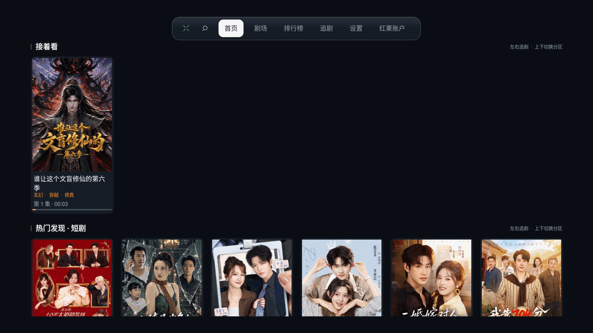
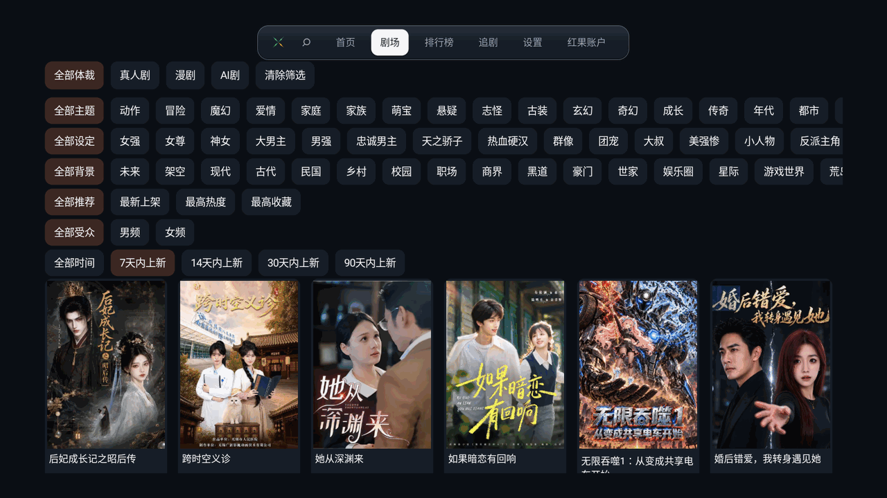
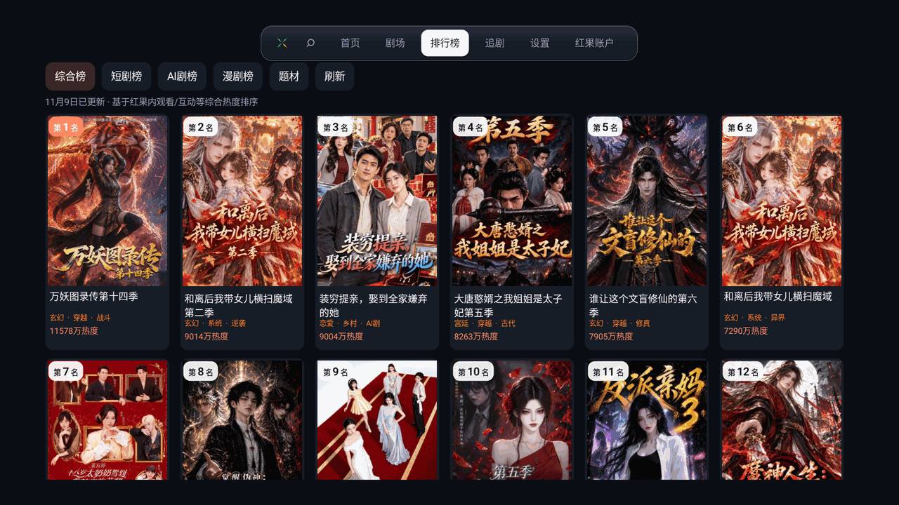
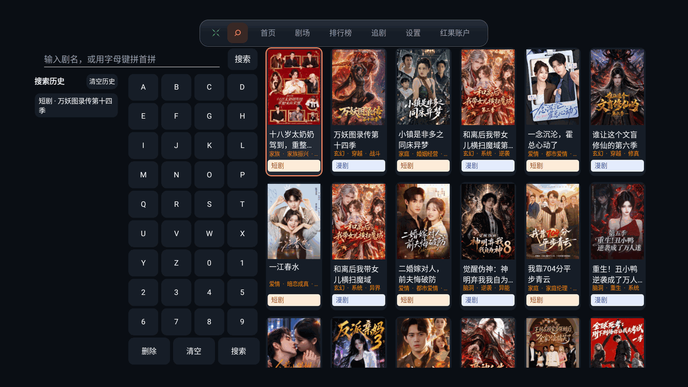
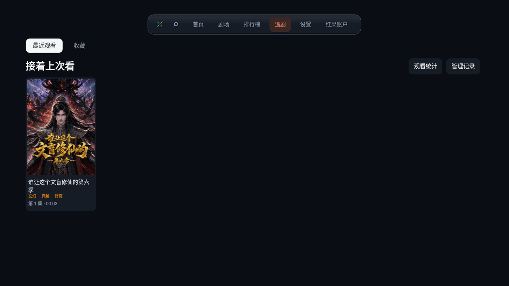
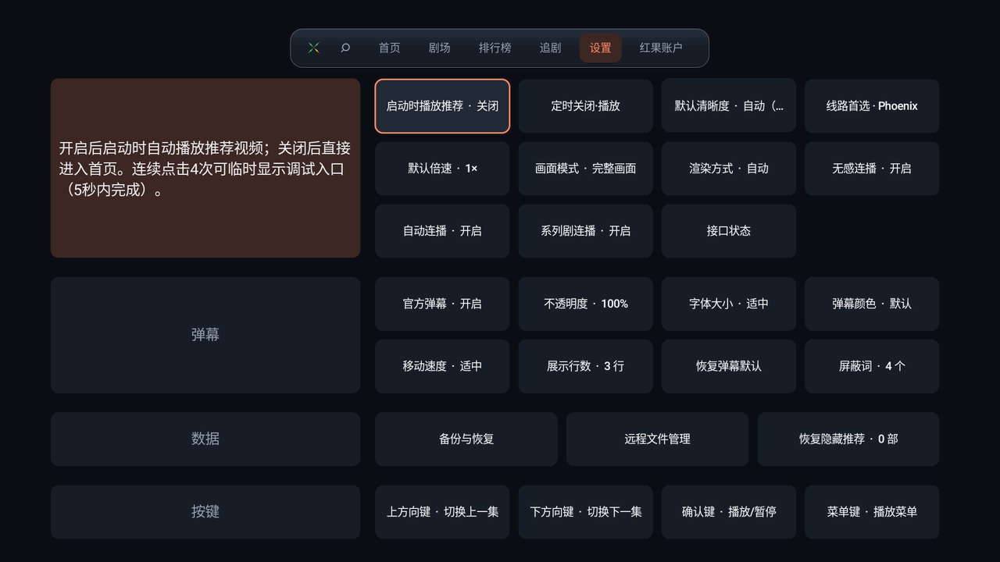

<div align="center">

<h1>红果TV</h1>

<p><b>在电视上，安静地看完一整部短剧。</b></p>

<p><sub>Kotlin · Jetpack Compose · Media3 / ExoPlayer · QuickJS　｜　单包约 2 MB　｜　只用遥控器</sub></p>

</div>

---

红果TV 是一个 Android TV 端的红果短剧客户端。界面用原生 Kotlin + Compose 从头写，播放走 ExoPlayer。
**数据层不在安装包里**——目录、详情、播放地址、弹幕、账号，全部由一份云端下发的 `main.js` 在设备本地执行。

改脚本不用重新发版。这是这个项目唯一重要的设计。

## 下载

### 正式版

<!-- OFFICIAL_RELEASE_INFO_START -->
- **当前版本：1.1.49**（versionCode：2026112002）
- 应用包名：`com.x.hongguotv`
- [下载正式版 APK：HongGuoTV-1.1.49.apk](https://github.com/xycvip/AppDownload/releases/download/hongguotv-v1.1.49/HongGuoTV-1.1.49.apk)
- [查看正式版 1.1.49 发布说明](https://github.com/xycvip/AppDownload/releases/tag/hongguotv-v1.1.49)
<!-- OFFICIAL_RELEASE_INFO_END -->

### 测试版

<!-- TEST_RELEASE_INFO_START -->
- **当前版本：0.0.102**（versionCode：102）
- 应用包名：`com.x.hongguotv.bate`
- [下载测试版 APK：HongGuoTV-0.0.102.apk](https://github.com/xycvip/HongGuoTV/releases/download/hongguotv-bate-v0.0.102/HongGuoTV-0.0.102.apk)
- [查看测试版 0.0.102 发布说明](https://github.com/xycvip/HongGuoTV/releases/tag/hongguotv-bate-v0.0.102)
<!-- TEST_RELEASE_INFO_END -->

> 两个包名不同，可以同时装，版本号各自独立。测试版是开发用的，随时会坏。

## 界面

<table>
<tr>
<td width="50%"><br>
<b>首页</b><br><sub>接着看，再看热门。两个区一起滚，不打断</sub></td>
<td width="50%"><br>
<b>剧场</b><br><sub>按题材分栏，竖排往下翻</sub></td>
</tr>
<tr>
<td><br>
<b>排行榜</b><br><sub>总榜、真人剧、漫剧、AI 剧</sub></td>
<td><br>
<b>搜索</b><br><sub>屏幕键盘，首拼全拼都能打，带联想和热搜</sub></td>
</tr>
<tr>
<td><br>
<b>追剧</b><br><sub>观看历史与收藏，一处管理</sub></td>
<td><br>
<b>设置</b><br><sub>无界设置，DNS、脚本、播放全在这里</sub></td>
</tr>
</table>

## 四个关键决定

| 决定 | 为什么 |
| --- | --- |
| **数据层放云端** | APK 里没有任何业务脚本。启动只做一件事：确认本地有一份能跑的 `main.js`。接口变了、解析改了、加了新页面，推脚本就行，用户不用升级 |
| **失败也得能活** | 六条线路竞速取清单（GitHub 直连加几个加速镜像），逐项校验才落盘：长度、HTML 嗅探、尾部 `module.exports`、sha256、QuickJS 编译通过。旧版留一份 `main.js.prev`，坏了能退回去 |
| **首屏不等网络** | 有缓存直接上屏，零请求。用户切到别的页面后，才静默补一次刷新；一直停在首页超过 45 秒再兜底。回首页超过 5 分钟才重拉 |
| **只认遥控器** | 五向键走完全部流程：选剧、翻页、输手机号、敲验证码、调弹幕。登录页自带屏幕数字键盘，不依赖电视输入法 |

## 工程结构

| 模块 | 职责 |
| --- | --- |
| `app` | Compose 界面、页面导航、播放器、遥控器焦点、账号与设置 |
| `core` | 内容仓库、网络（DNS / 连接池 / 重试）、脚本清单与更新、书架历史、备份 |
| `playback-js` | QuickJS 运行时、脚本落盘与校验、JS 门面（目录 / 详情 / 取流 / 账号 / 弹幕） |
| `playback-media` | MP4 解析、加密样本处理、远程 seek、断点重试 |
| `playback-api` | `StreamInfo` / `StreamSource` 抽象，播放器只认这一层 |

## 构建

需要 JDK 17、Android SDK 36，Gradle 8.14.3 由 wrapper 带下来。

```bash
cd kotlin-tv
./gradlew :app:assembleDebug     # 测试包 com.x.hongguotv.bate
./gradlew :app:assembleRelease   # 正式包 com.x.hongguotv
```

- `minSdk 26`（Android 8.0），产物 `armeabi-v7a` + `arm64-v8a`
- 签名读 `kotlin-tv/keystore.properties`，这个文件不入库
- 版本号在 `version.properties` 与 `test-version.properties`，发布工作流自动递增

## 脚本怎么发

脚本的源和分发在另一个仓库：[xycvip/RedGuoAPI](https://github.com/xycvip/RedGuoAPI)。

```
RedGuoAPI
├── script/main.js                    只改这里
├── .github/workflows/发布客户端脚本.yml
└── dist/                             工作流生成，不要手改
    ├── index.json                    版本 / 大小 / sha256 / 路径
    └── hongguoTV/HongGuoTV.js        客户端真正下载的文件
```

推一次 `script/main.js`，工作流生成带哈希的 `dist`，客户端最长 3 小时后自己换上新脚本。

客户端这边的节奏：启动 1.5 秒后查清单 → 哈希一样就零下载 → 有更新后台拉、校验、原子落盘 →
等首屏空闲再重建 JS 实例，立刻生效。**播放中不切换**，退出播放页时补上。

脚本能调用的宿主接口，见 [JS 接口消费清单](kotlin-tv/docs/JS接口消费清单.md)。

## 来源与许可

派生自 [N3urda/hongguoTV](https://github.com/N3urda/hongguoTV) 与 [jycao2/hongguoTV](https://github.com/jycao2/hongguoTV)：
原生工程骨架、内容访问与播放基础设施来自前者，账号、弹幕、片源、备份等实现与后者有继承关系。
本项目重写了界面层和网络层，把业务脚本整体移出了 APK。

`MediaCrypto` 等媒体处理与签名算法移植自 drpys，六头签名参考 fyworld/hongguoTV，原始著作权归各自权利人。

以 **GPL-3.0** 发布，全文见 [LICENSE](LICENSE)。仅供学习与技术研究，内容版权归原平台所有。
